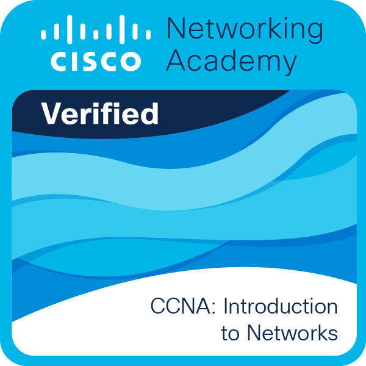
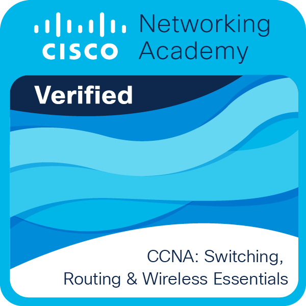
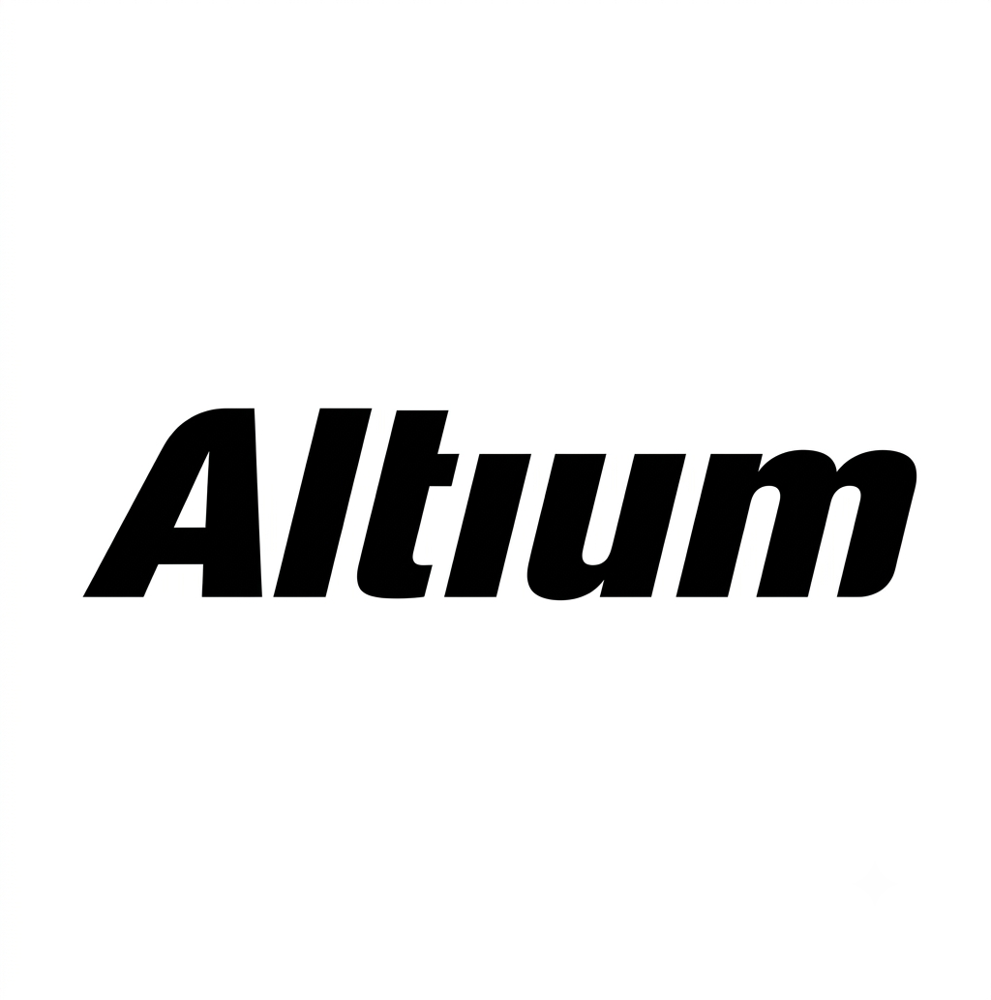
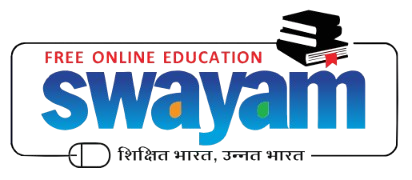
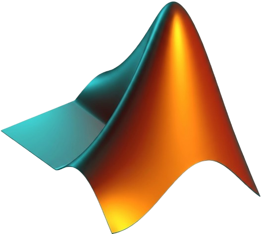
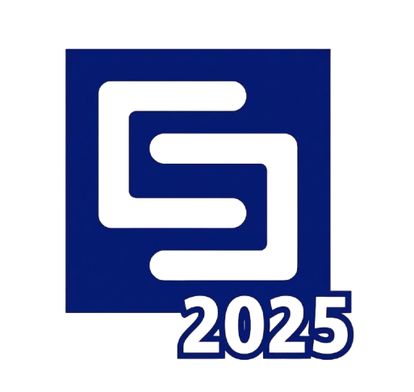

# Sudarshan V
Electronics and Communication Engineering student at College of Engineering, Guindy, with hands-on experience in embedded systems, PCB design, IoT, digital hardware design, and wireless communication.

## Contact

  
  
  

Location: Chennai, Tamil Nadu, India

## Experience
**BaSig Wireless — Internship (2026)**
Engineered Layer 2/3 protocols for 5G core signaling, including NGAP (3GPP TS 38.413) and NAS (3GPP TS 24.501) message codecs in Python with APER encoding validation. Achieved bit-exact protocol compliance through empirical encoding analysis and Wireshark-based debugging.

## Certifications

  
  

Currently pursuing the academic-level CCNA course, studying **Module 3: CCNA — Enterprise Networking, Security, and Automation**.

-  **Altium – PCB Design** (2026) — [Certificate](assets/altium-pcb-design-2026.pdf)
-  **Verilog HDL: VLSI Hardware Design Comprehensive Masterclass** – Udemy (2026) — [Certificate](https://www.udemy.com/certificate/UC-31514106-8c25-4d97-9ec2-4c72bcf5e9f2/)
-  **NPTEL Data Science with Python** (2025) — [Certificate](assets/nptel-data-science-python-2025.jpeg)
-  **MATLAB Onramp** (2025) — [Certificate](assets/matlab-onramp-2025.pdf)
-  **Simulink Onramp** (2026) — [Certificate](assets/simulink-onramp-2026.pdf)
-  **CCNA – Academic Certification** (2026) — [Certificate](https://www.credly.com/earner/earned/share/7b35ad95-0864-42d5-886c-295173bf8ae8)

## Completed Projects
**5G NGAP/NAS Codecs** (2026)
Repository: https://github.com/Sudarshan-veera/5g-ngap-nas-codecs
Python implementation of NGAP and NAS message codecs for 5G core network signaling, developed during the BaSig Wireless internship. Implements APER encoding and decoding for 3GPP TS 38.413 (NGAP) and 3GPP TS 24.501 (NAS) message formats. Validated for bit-exact protocol compliance and malformation-free transmission using Wireshark-based debugging and empirical encoding analysis.

**ANGEL BOT — IoT-Based Disaster Rescue Robot** (2026)
Repository: https://github.com/Sudarshan-veera/Angel-bot
ESP32-based IoT disaster rescue robot built to assist rescue teams by monitoring hazardous environments and reducing secondary casualty risk. Integrates an ESP32-CAM for real-time video streaming, an INMP441 MEMS microphone with I2S protocol for bidirectional live audio monitoring, and an MQ-135 gas sensor for hazardous gas and air quality detection. Wireless remote control and real-time sensor data transmission are handled through Blynk IoT, with DumbDisplay providing a secondary lightweight visual interface for operators. Designed to operate in rough, unstable terrain typical of disaster zones.

**LoRa Campus Chat System Using Token Passing** (2026)
Repository: https://github.com/Sudarshan-veera/LoRA-WAN_CampusChat
LoRaWAN-based low-power, long-range communication system enabling message passing between distributed nodes across a campus. Implements a token-passing algorithm ensuring collision-free communication with 5-second transmit windows per node. Network behavior was simulated and validated in NS-3 using the Ninja build system, achieving zero packet loss across tested distances of 20m, 30m, and 50m. Includes a MATLAB/Simulink model simulating the physical-layer chirp spread spectrum (CSS) signal used in LoRa modulation and demodulation.

**Tiny Tapeout Project** (2026)
Repository: https://github.com/Sudarshan-veera/TT_proj
Verilog-based digital design developed for submission to Tiny Tapeout, an educational program that fabricates student-designed chips on real silicon. Built as part of Anna University CEG's student-level chip tapeout initiative, with automated build and verification pipelines for GDS generation, documentation, testing, and FPGA synthesis.

## Technical Skills
Languages: Python (NumPy, Pandas, Matplotlib, Seaborn), C, C++ (DSA)
Tools: MATLAB, Simulink, CST Studio Suite, GNU Radio, LTspice, Altium Designer, NS-3, Wireshark, Cisco Packet Tracer, Adobe Illustrator, Adobe Photoshop
Development Tools: VS Code, PyCharm, GitHub, Arduino IDE, ESP-IDF, STM32 CubeIDE, Docker, Linux

### 💻 Languages and Tools

  
  
  
  
  
  
  
  
  
  
  
  
  

